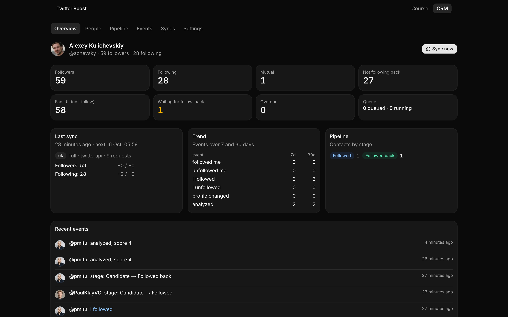
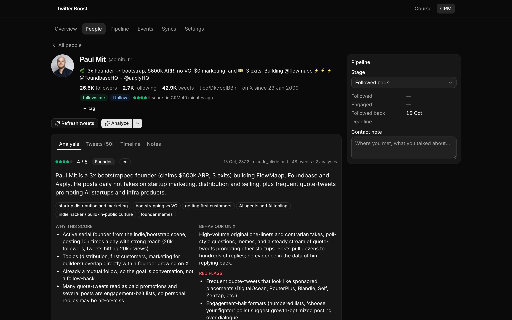
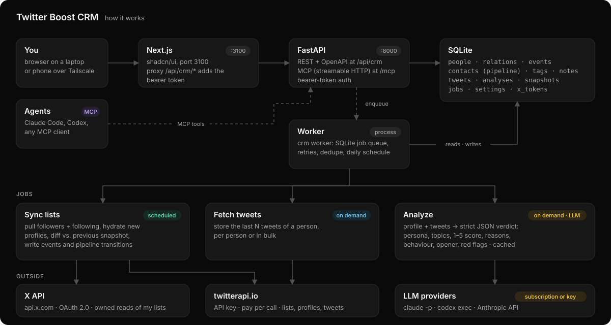

# Twitter Boost CRM

A self-hosted CRM for your own X (Twitter) account. It is for people who grow an
audience by hand: follow someone, comment on their posts, see whether they follow back,
unfollow if they do not.

X does not tell you who unfollowed you or when. This tool takes a snapshot of your
followers and following lists every day, diffs the snapshots into events, and keeps every
contact in a small pipeline. When you want to know who someone is, it pulls their recent
tweets and asks an LLM for a structured verdict. The same data and actions are exposed
over REST and MCP, so Claude Code or Codex can work the pipeline with you.

Single user, SQLite, two Python processes and a Next.js app. Runs on a Mac mini at home.





## What it does

- Stores full follower and following snapshots and writes `followed_me`,
  `unfollowed_me`, `i_followed`, `i_unfollowed` and `profile_changed` events. An unfollow
  counts only after the person is missing from two consecutive syncs. If a fetched list
  is shorter than the profile counter says, the sync is marked suspicious and writes no
  events.
- Moves contacts through `candidate`, `followed`, `engaged`, `followed_back`,
  `no_response` (after a deadline, 7 days by default), `unfollowed`, `lost` and `ignored`.
  Sync events drive the transitions; you can override any stage by hand.
- Fetches a person's last 50 tweets and returns a verdict with a fixed schema: persona,
  topics, a 1 to 5 relevance score with reasons, posting behaviour, a draft opener in the
  person's language, red flags. Verdicts are cached by input hash.
- Runs the model through Claude Code CLI (your Anthropic subscription), Codex CLI (your
  ChatGPT subscription) or the Anthropic API.
- Reads X data through the official X API v2 (OAuth 2.0) or through
  [twitterapi.io](https://twitterapi.io), chosen per operation. A `fake` source generates
  test data so you can try the UI without keys.
- Filters people by relation, stage, tag, follower count, score, recent events and free
  text. The same filter object drives the table, saved views, bulk actions, REST and MCP.
- Exposes 15 MCP tools and a REST API with OpenAPI docs.

## How it works



The worker runs three kinds of jobs. A sync pulls both lists, hydrates profiles it has
not seen, diffs them against the stored state and writes events and pipeline
transitions. A tweet fetch stores a person's recent tweets. An analysis sends the
profile and the stored tweets to the LLM with a JSON schema and saves the result. Syncs
run on a schedule; the other two run when you or an agent ask. Nothing posts, follows or
unfollows on your behalf.

The sync algorithm and the data model are described in [`backend/README.md`](backend/README.md).

## Requirements

- macOS or Linux, Node.js 20+, Python 3.12+ and [uv](https://docs.astral.sh/uv/).
- A data source: a twitterapi.io API key, an X developer app with OAuth 2.0, or both.
- An analysis provider: Claude Code logged in on this machine (`claude /login`), Codex CLI
  logged in (`codex login`), or an Anthropic API key.

## Install

```bash
git clone https://github.com/kulichevskiy/twitter-boost.git
cd twitter-boost

cd backend
cp .env.example .env            # set MY_HANDLE, TWITTERAPI_IO_KEY and CRM_API_TOKEN (uv run crm token)
uv sync
uv run crm serve                # API on http://localhost:8000, applies migrations on start
uv run crm worker               # second terminal: jobs and the daily schedule

cd ..
npm install
cp .env.example .env.local      # CRM_API_TOKEN must match backend/.env
npm run dev                     # http://localhost:3100
```

Open `http://localhost:3100/crm` and press "Sync now". The first sync is a baseline and
writes no events; diffs start with the second one. Open a person and press "Analyze".

To try it without keys, set `SOURCE_LISTS`, `SOURCE_TWEETS` and `SOURCE_PROFILES` to
`fake` in `backend/.env`.

## Configuration

Settings live in `backend/.env` ([`backend/.env.example`](backend/.env.example) lists
them all). The Settings page in the UI edits most of them; values saved there go to
SQLite and override the file.

| Setting | Where it comes from |
| --- | --- |
| `MY_HANDLE` | your handle without `@`; connecting X fills it in |
| `TWITTERAPI_IO_KEY` | twitterapi.io dashboard |
| `X_CLIENT_ID`, `X_CLIENT_SECRET` | developer.x.com, your app, Keys and tokens, OAuth 2.0 |
| `ANALYSIS_PROVIDER` | `claude_cli` (default), `codex_cli` or `anthropic_api` |
| `ANALYSIS_MODEL` | optional; empty means the provider default |
| `ANTHROPIC_API_KEY` | only for `anthropic_api` |
| `CRM_API_TOKEN` | `uv run crm token`; the same value goes into `.env.local` |
| `SOURCE_LISTS`, `SOURCE_TWEETS`, `SOURCE_PROFILES` | `twitterapi`, `x` or `fake` |

### Choosing a data source

| | X API, pay per use (Oct 2026) | twitterapi.io |
| --- | --- | --- |
| Your own follower and following lists | $0.001 per account | about $0.00001 per entry |
| Another user's profile | $0.010 | about $0.00001, batched |
| One tweet | $0.005 | $0.00015 |
| Terms | official API | third party that scrapes X |
| Needs | an OAuth app and your login | an API key |

A good split while the account is small is `SOURCE_LISTS=x` and twitterapi.io for tweets
and profiles. Reads of your own lists are cheap on the X API, and the OAuth connection is
what write actions would need later. Above a few thousand followers, move lists to
twitterapi.io too. Check current prices before relying on this table.

### Setting up the X app

1. Create an app at developer.x.com. App permissions: Read. Type of app: Web App,
   Automated App or Bot (a confidential client).
2. Callback URI: `<PUBLIC_BASE_URL>/api/crm/auth/x/callback`, for example
   `http://localhost:3100/api/crm/auth/x/callback`. The Settings page shows the exact
   value. Website URL: any real page, such as your X profile.
3. Copy the OAuth 2.0 Client ID and Client Secret into Settings or `.env`.
4. In Settings, press "Connect X". The app requests `tweet.read users.read follows.read
   offline.access` and refreshes tokens on its own.

## Running it permanently

On macOS, `backend/launchd/install.sh` installs the API and the worker as launchd agents
for the current user. Logs go to `backend/data/api.log` and `backend/data/worker.log`. On
Linux, run `uv run crm serve` and `uv run crm worker` from `backend/` as two systemd
units. For the frontend, `npm run build && npm start`.

The frontend listens on `0.0.0.0:3100`, so a phone on the same network or your Tailscale
tailnet can open it. Set `CRM_API_TOKEN` if anything other than localhost can reach port
8000; the backend then requires it on every request.

## API and MCP

REST lives at `http://<host>:8000/api/crm/*` with docs at `/api/crm/docs`, header
`Authorization: Bearer <CRM_API_TOKEN>`. The same paths work through the frontend on
port 3100, where the proxy adds the header.

MCP uses streamable HTTP at `http://<host>:8000/mcp` with the same bearer token.

```bash
# Claude Code
claude mcp add --transport http twitter-crm http://localhost:8000/mcp \
  --header "Authorization: Bearer <CRM_API_TOKEN>"

# Codex CLI
export CRM_API_TOKEN=<CRM_API_TOKEN>
codex mcp add twitter-crm --url http://localhost:8000/mcp --bearer-token-env-var CRM_API_TOKEN
```

Tools: `search_people`, `get_person`, `find_by_handle`, `list_events`, `get_pipeline`,
`set_stage`, `add_note`, `tag_person`, `lookup_handle`, `fetch_tweets`, `analyze`,
`bulk_action`, `run_sync`, `get_job`, `sync_status`. Actions that cost money (sync,
lookup, tweets, analysis) return a job; poll `get_job` for the result.

A prompt that works: "Find everyone I followed more than 7 days ago who has not followed
back, analyze the ones with 500+ followers, and tag the ones scoring 4 or 5 as `keep`."

## Cost

With about 100 followers and one sync a day on twitterapi.io, a sync costs about one
cent, so under a dollar a month. An analysis fetches about 50 tweets for under a cent
and makes one model call, which is free on a subscription provider and a few cents on the
API. At tens of thousands of followers, the daily list sync costs a few dollars a month
on twitterapi.io and hundreds on the X API.

## Data

Everything is in `backend/data/crm.db`: public profiles and tweets of the people in your
lists, your OAuth tokens, your notes, and the full id lists of every sync (zstd
compressed). With twitterapi.io your queries go to a third party; with the X API they go
to X. The model provider sees the profile and tweets you send for analysis.

## Limits

- Event time is sync time, because X does not expose follow timestamps. Sync more often
  for finer resolution; each sync costs a little.
- One account, one user. Multi-account would need an `account_id` on most tables.
- No write actions. Follow and unfollow through the X API (`follows.write`) is the
  obvious next step. twitterapi.io stays read-only here on purpose.
- The analysis prompt is written for founder networking. Change `ANALYSIS_GOAL`, or
  edit `backend/app/services/analysis.py`, for other goals.

## License

MIT, see [LICENSE](LICENSE).
